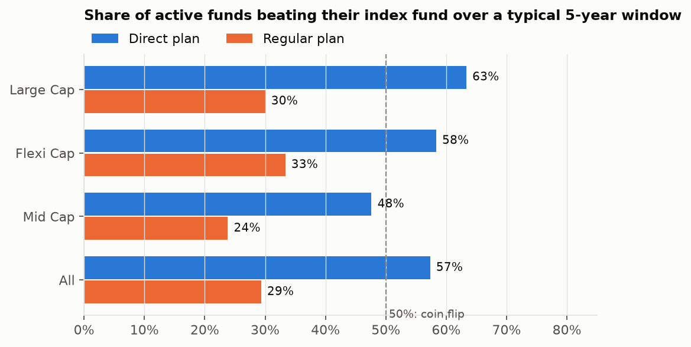

# Do Indian active mutual funds beat index funds after costs?

**Short answer: barely, and only in the direct plan.**

Over rolling 5-year windows, **57%** of active Large Cap, Flexi Cap and Mid Cap funds beat a
low-cost index fund in their category, comparing direct plan to direct plan. In the regular plan
that distributors sell, only **29%** do. The regular plan's commission costs a median **1.32% a
year**, or about **₹1.31 lakh** on a ₹10,000/month SIP over 10 years. That is far more than the
typical active fund's +0.19% a year edge.

| 5-year windows | Direct plans beating the index | Regular plans beating the index |
|---|---|---|
| Large Cap (vs Nifty 50 index fund) | 63% | 30% |
| Flexi Cap (vs Nifty 500 index fund) | 58% | 33% |
| Mid Cap (vs Nifty Midcap 150 index fund) | 48% | 24% |
| **All** | **57%** | **29%** |

The edge also isn't stable. The share of large-cap funds beating the Nifty 50 over 5 years
swings from 12% to 96% depending on the period.

**Recommendation:** always choose direct plans. Use an index fund as the core, especially in mid
caps. Hold active funds only as a satellite.

Full write-up: [reports/findings.md](reports/findings.md) · Analysis: [notebooks/findings.ipynb](notebooks/findings.ipynb)



---

## How to run

Requires Python 3.11+. Commands are shown as plain Python so they work on Windows without
`make`; `make <target>` runs the same thing.

```bash
python -m venv .venv
.venv/Scripts/activate            # Windows; on macOS/Linux: source .venv/bin/activate
pip install -r requirements.txt
cp .env.example .env
```

**Database.** Pick one:

- **Docker:** `docker compose up -d`, then in `.env` uncomment `DATABASE_URL` (and leave
  `USE_EMBEDDED_PG` as is; `DATABASE_URL` takes priority).
- **No Docker:** nothing to install. A real Postgres 16 ships inside the `pgserver` wheel and
  stores its data in `~/.mf-analytics/pgdata`. Start it once with `python -m src.db start`
  (`make db`) so the pipeline and dashboard share one server.

**Pipeline**

```bash
python -m src.pipeline ingest     # ~3 min first run: AMFI snapshots + ~270 NAV histories, cached in data/raw/
python -m src.pipeline load       # clean, pair plans, load tables
python -m src.pipeline metrics    # build the SQL views (~10 s)
python -m pytest -q               # metric tests on synthetic NAV series
```

`python -m src.pipeline all` runs all three steps. `--sample 10` ingests a 10-scheme sample;
`--refresh` re-downloads cached histories.

**Dashboard**

```bash
streamlit run dashboard/app.py    # run from the repo root so .streamlit/config.toml is picked up
```

Three pages: **Headline** (the big number, beat rate by category, beat rate over time),
**Fund report card** (any fund's rolling excess return, metrics and direct-vs-regular SIP gap),
and **Leaderboard** (sortable and filterable).

**Notebook:** `make notebook` regenerates and executes `notebooks/findings.ipynb` and the charts
in `reports/figures/`.

## Stack

Python · pandas · requests · PostgreSQL 16 (Docker or embedded via pgserver) · SQLAlchemy +
psycopg 3 · SQL materialized views for every metric · Streamlit + Plotly · matplotlib · pytest

## How it works

```
mfapi.in ─┐                               sql/views/ (materialized, run in order)
AMFI ─────┴─> data/raw/ ─> clean ─> Postgres ─> 01 trading_calendar ─> 02 nav_filled
          ingest          load       tables     03 rolling_returns ─> 04 excess_returns
                                                05 fund_beat_rates · 06 risk_metrics
                                                07 direct_regular_gap · 08 category_summary
                                                09 survivorship · 10 headline · 11 fund_leaderboard
```

- **Universe.** Every scheme code AMFI lists under Large Cap, Flexi Cap or Mid Cap, in today's NAV
  file *or* in any quarterly NAV history file since 2013. Including the history files brings
  back funds that later merged or closed. Growth options only. Categories come from mfapi
  metadata, falling back to AMFI's.
- **Benchmarks** (`config/benchmarks.yaml`) are direct-plan index funds, so the comparison is
  investable and already net of the index fund's costs.
- **Pairing.** Direct and regular plans are paired by a normalized name key. Legacy share classes
  (e.g. Edelweiss "Plan B") that ran alongside the main plan are dropped. Every exclusion is
  logged in `scheme_log`.
- **Cleaning.** Zero or negative NAVs are dropped and logged. Single-day moves above 20% are
  logged in `nav_flags` and kept.
- **Calendar.** NAVs are forward-filled onto a common trading calendar, used only for returns. A
  rolling window is skipped if under 95% of its trading days have a real NAV, or if its start or
  end NAV is more than 7 days stale.
- **Metrics.** CAGR = (end/start)^(365/days) − 1, on rolling 1/3/5-year windows sampled monthly.
  Beat rate is the share of windows above the index fund. Volatility (×√252), Sharpe and Sortino
  use a 6.5% risk-free rate, set in `config/settings.yaml`. Also: max drawdown, and the
  direct-vs-regular gap as a return difference and as a ₹10,000/month SIP over 10 years.
- **Checks.** NAVs match AMFI's own files on 7,900 sampled points. Tests run the real SQL views
  on synthetic series with known answers: constant 12% growth gives 12% CAGR and zero drawdown,
  gaps never distort CAGR, and Sharpe and Sortino match a numpy reference.

## Limitations

The Nifty 500 and Midcap 150 index funds only start in Sep 2019, so Flexi Cap and Mid Cap 5-year
windows cover just Sep 2024 to Oct 2026. Survivorship bias is reduced, not removed: funds that
closed before the 2018 SEBI recategorisation can't be categorised. The Nifty 50 is a narrower
benchmark than large-cap funds' actual universe. Categories are as of today. Taxes and exit
loads are ignored. Details are in [reports/findings.md](reports/findings.md).

## Repo layout

```
config/       benchmarks.yaml (category -> index fund), settings.yaml (risk-free rate, windows, SIP)
src/ingest/   AMFI + mfapi fetchers, polite HTTP, universe builder
src/clean/    scheme classification and pairing, NAV cleaning
src/load.py   COPY into Postgres          src/db.py   Docker URL or embedded Postgres
sql/          schema.sql, views/ (one file per metric)
dashboard/    Streamlit app               notebooks/  findings notebook (+ its generator)
tests/        metric tests on synthetic NAVs, cleaning/parsing tests
reports/      findings.md, figures/
```
