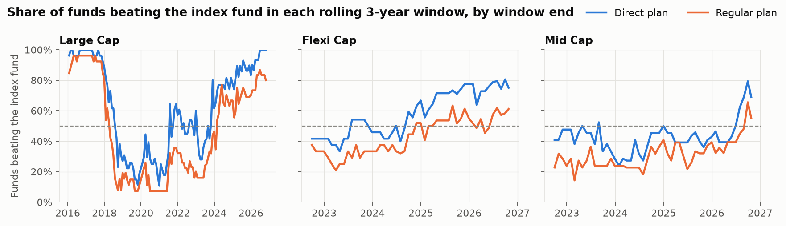

# Findings: do Indian active mutual funds beat index funds after costs?

*Data to 26 Oct 2026. 128 active Large Cap, Flexi Cap and Mid Cap funds (256 direct and
regular plans, growth option), including 13 that have since closed or merged. Each fund is compared with a
direct-plan index fund in its category: Nifty 50 (Large Cap), Nifty 500 (Flexi Cap) and
Nifty Midcap 150 (Mid Cap). Method and code: `notebooks/findings.ipynb`, `sql/views/`.*

## Headline

> **57% of active funds beat their index fund over a typical 5-year period. That is barely
> better than a coin flip, and it only holds in the direct plan.** In the regular plan that
> distributors sell, just **29%** do.

43 of 75 direct-plan funds with enough history have a positive median rolling 5-year return
over the index fund. The typical edge is +0.19% a year. The commission built into the regular
plan costs a median 1.32% a year, which is far larger than that edge.

## Supporting numbers

1. **Mid Cap is the weakest case for active management.** Only 48% of direct mid-cap funds
   (10 of 21) beat the Nifty Midcap 150 index fund, and 24% of regular plans do. Large Cap
   direct plans: 63%. Flexi Cap: 58%.
2. **The regular plan costs a median 1.32% a year** (105 fund pairs, range 0.1% to 2.2%). On a
   ₹10,000/month SIP over 10 years (₹12 lakh invested), the direct plan ended **₹1.31 lakh
   ahead** at the median (57 funds with the full 10 years).
3. **There is no stable edge: the result flips with the market cycle.** The share of direct
   large-cap funds beating the Nifty 50 over 5 years ranged from **12%** (windows ending
   Apr 2022) to **96%** (Feb 2018). Large Cap funds can hold mid caps, so they look skilled
   whenever mid caps beat the Nifty 50.
4. **Across all fund-windows**, direct plans beat the index fund 56% of the time and regular
   plans 37% of the time.

## Recommendation

- **Use direct plans.** This is the one decision that reliably pays: about 1.3% a year, or
  roughly ₹1.3 lakh per ₹12 lakh of SIP over ten years. It needs no skill in picking funds.
- **Default to a low-cost index fund for the core of an equity portfolio, especially in mid
  caps.** Fewer than half of active mid-cap funds beat the index even before commissions.
- **Treat any active fund as a satellite, chosen in its direct plan.** In large and flexi caps
  the active edge has been small and depends on the period. An investor who can't monitor and
  switch funds is better served by the index.

## Limitations

- **Short benchmark history for Flexi Cap and Mid Cap.** Nifty 500 and Midcap 150 index funds
  launched in Sep 2019, so all their 5-year windows end between Sep 2024 and Oct 2026. That
  covers essentially one market cycle. Large Cap windows go back to 2018.
- **Survivorship bias is reduced, not removed.** Funds that closed after the 2018 SEBI
  recategorisation are included. Of 66 direct-plan funds alive in Oct 2016, 9 have since closed
  or merged. Funds that closed before or during the recategorisation (374 legacy "Growth"
  plans) can't be categorised and are missing. Merged funds are usually poor performers, so the
  57% probably flatters active funds.
- **Benchmark fit.** The Nifty 50 is narrower than the top-100 universe Large Cap funds invest
  in, so part of their measured "excess" is a mid-cap tilt.
- **Categories are as of today**, applied to each fund's whole history. Taxes and exit loads
  are ignored.
- **Data:** NAVs from mfapi.in, cross-checked against AMFI's history files (100% match on
  7,900 sampled NAVs). Zero/negative NAVs were dropped and logged (6 rows). No single-day
  moves above 20% were found.
